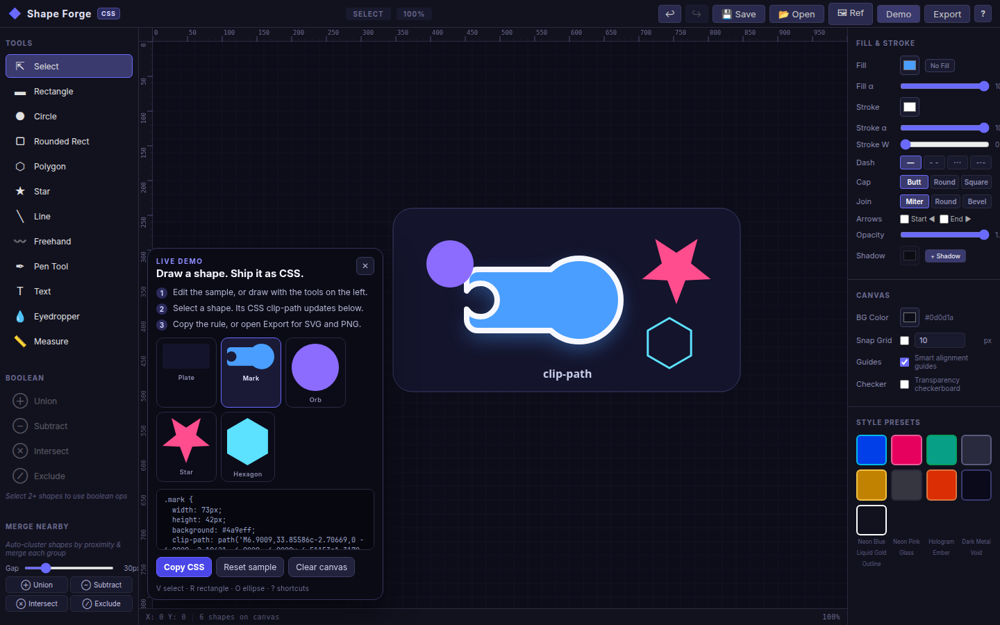
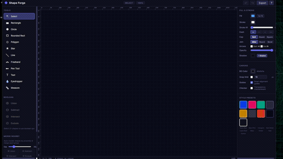
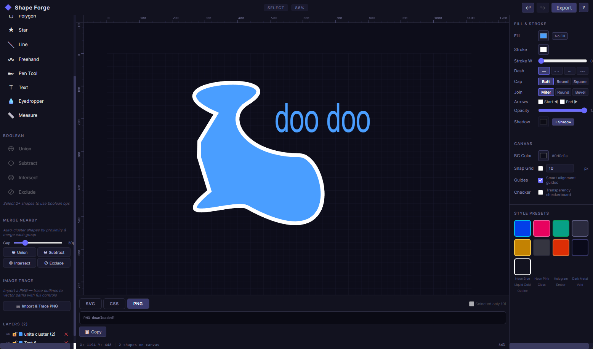
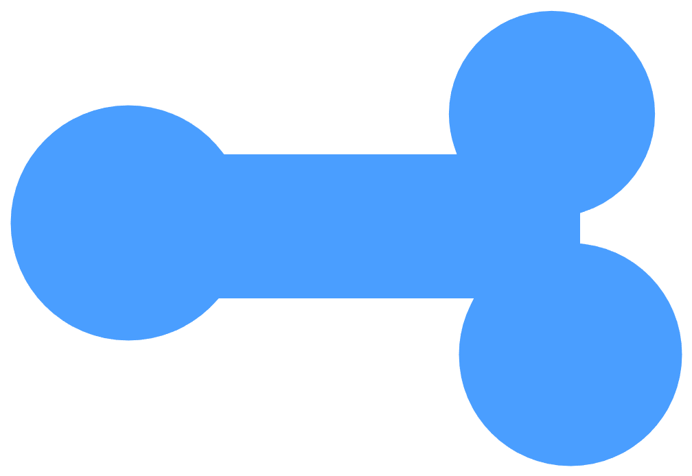

# Shape Forge CSS

## Project Summary

Shape Forge CSS is a browser-based vector editor for building shape systems and exporting them as web-ready assets. It combines direct manipulation drawing, image tracing, boolean operations, and CSS `clip-path` export in a single interface.

## Why This Exists

Design tooling often breaks into disconnected steps: sketch a shape, trace it somewhere else, clean it up in another tool, then translate it again for the browser.

Shape Forge CSS explores a tighter workflow. The idea is to keep the visual editing surface and the code-oriented output in one place so designers and creative technologists can move faster between experimentation and implementation.

## Live demo

The editor ships as a static site. After this lands on `main`, GitHub Pages publishes it here:

**[Open the Shape Forge CSS demo](https://newjordan.github.io/shape-forge-css/)**



The page opens on a sample scene (a boolean mark, a few primitives, and a text label) and a guide that turns the selected shape into a real `clip-path`. Drawing, tracing, booleans, and SVG / PNG / CSS export all run in the browser.

Publishing uses [`.github/workflows/pages.yml`](.github/workflows/pages.yml). The repository needs GitHub Pages set to **GitHub Actions** once (Settings → Pages → Build and deployment → Source). The same `dist/` build is Vercel-ready via [`vercel.json`](vercel.json). Local and Vercel builds use base `/`. The Pages workflow sets `VITE_BASE=/shape-forge-css/` so asset URLs match the project site.

## Key Ideas or Features

- Draw and edit vector shapes directly in the browser.
- Trace PNG, JPEG, WebP, and GIF assets into editable vector paths.
- Apply boolean operations, grouping, alignment, transforms, and path simplification.
- Export SVG, PNG, or CSS `clip-path` output for web use.
- Use a live properties panel for styling, shadows, text, layers, and canvas controls.
- Work on an infinite canvas with rulers, snapping, guides, and keyboard shortcuts.

## How It Works (High Level)

1. React handles the editor shell, panels, and workspace layout.
2. Paper.js manages vector geometry, selection, and canvas interaction.
3. A tracing pipeline converts raster images into contours with marching squares and smoothing controls.
4. Zustand keeps editing state, tool state, history, and selection synchronized.
5. Export flows convert the active canvas into SVG, PNG, or CSS-ready path data.

## More captures







## Getting Started

### Requirements

- Node.js 20.19+ (Vite 7 does not run on Node 18)
- npm

### Run Locally

```bash
git clone https://github.com/newjordan/shape-forge-css.git
cd shape-forge-css
npm install
npm run dev
```

Open `http://localhost:5173`.

### Static build

```bash
npm run build
npm run preview
```

`npm run build` typechecks and writes the site to `dist/`. To reproduce the GitHub Pages asset prefix locally:

```bash
VITE_BASE=/shape-forge-css/ npm run build
```

## Future Experiments

- Add stronger import/export bridges for design-system workflows.
- Explore reusable shape libraries and prompt-assisted asset generation.
- Expand tracing controls for more stylized outputs.
- Add collaborative or review-oriented editing modes for interface teams.
